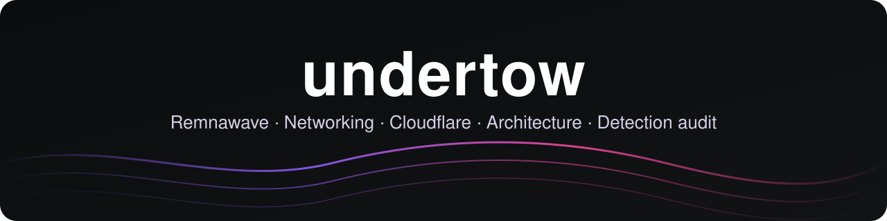
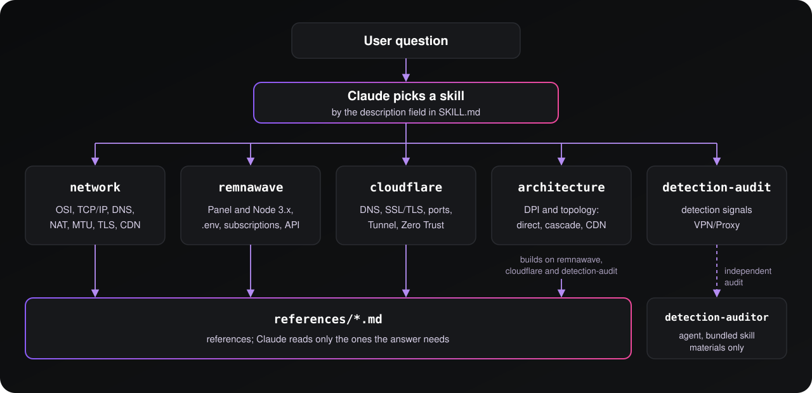

<!-- markdownlint-disable MD033 MD041 -->
<p align="center">
  
</p>

<p align="center">
  <a href="https://code.claude.com/docs/en/plugins"></a>
  <a href="plugins/undertow-en/.claude-plugin/plugin.json"></a>
  <a href="https://docs.rw"></a>
  <a href="LICENSE"></a>
</p>

<p align="center">
  🇬🇧 <b>English</b> · 🇷🇺 <a href="README.ru.md">Русский</a>
</p>

<p align="center">
  <a href="#installation">Installation</a> ·
  <a href="#skills">Skills</a> ·
  <a href="#license">License</a>
</p>

> A knowledge base for Claude Code: designing, deploying and auditing VPN infrastructure on Remnawave, based only on official sources.

**In short:** 5 skills · 1 agent · 58 references · Remnawave 3.x · Cloudflare · Xray-core · Networking fundamentals · VPN detection-signal audit.

> [!IMPORTANT]
> **Content principles**
>
> - Official sources only: [Remnawave Docs](https://docs.rw), [Remnawave GitHub](https://github.com/remnawave), [Cloudflare](https://developers.cloudflare.com), RFCs, vendor documentation, and for the audit, a bundled copy of the methodology.
> - Anything not confirmed by a source is marked explicitly; undocumented fields and schemas are never invented.
> - Commands are given for the user's server; skills do not search files on the local computer.
> - Secrets (UUIDs, keys, tokens, subscription links) are never printed.

## Skills

| Skill | What it covers | When it triggers |
| --- | --- | --- |
| `undertow-en:remnawave` | Remnawave 3.x: installing and upgrading Panel and Node, `.env`, reverse proxy, Node Plugins, Config Profiles, cascade between Nodes, users, subscriptions, API, troubleshooting | Any task about Remnawave Panel and Node |
| `undertow-en:network` | Networking fundamentals: OSI, TCP/IP, DNS, NAT/CGNAT, MTU/MSS, TLS/mTLS, HTTP/2 and HTTP/3, CDN, BGP, reverse proxy, firewall, Linux networking | Explaining concepts and diagnosing connectivity |
| `undertow-en:cloudflare` | DNS, Proxied and DNS only, SSL/TLS modes, proxy ports, WebSocket and gRPC, WAF, Tunnel, Zero Trust | Publishing Panel, the subscription page or a Node through Cloudflare |
| `undertow-en:architecture` | Diagnosing blocking (DNS, IP, SNI/TLS, fingerprint, shaping, UDP/QUIC) and choosing a topology: direct, cascade, CDN, selective WARP, relay | Choosing or revisiting a circumvention setup, questions about DPI |
| `undertow-en:detection-audit` | Auditing a setup for VPN/proxy detection signals: GeoIP, ASN, hosting, DNS, routes, MTU, Android/iOS/desktop signals, latency, HTTP headers | Before the final decision on a setup, "is the VPN noticeable" |

<details>
<summary><b>remnawave</b> — 11 references</summary>

| File | Topic |
| --- | --- |
| `install.md` | Fresh installation of Panel and Node, `.env`, reverse proxy |
| `upgrade.md` | Upgrading within 3.x and moving from 2.x to 3.x, determining the current version |
| `discovery.md` | Finding components on the server with a non-standard installation |
| `nodes.md` | Nodes and Node Plugins (Torrent Blocker, Ingress/Egress Filter, Connection Drop, Shared Lists) |
| `config-profiles.md` | Config Profiles, inbounds, snippets, Internal Squads, server-side routing and cascade |
| `users.md` | Users, limits, HWID |
| `subscriptions.md` | Hosts, Templates, Response Rules, Subscription Page |
| `api.md` | REST API, API Tokens and their scopes |
| `happ-routing.md` | Happ Routing and its limits |
| `troubleshooting.md` | SPAWN_ERROR, xlogs, Rescue CLI, common errors |
| `sources.md` | Official sources |

</details>

<details>
<summary><b>network</b> — 25 references</summary>

`osi-model` · `tcp-ip` · `tcp-vs-udp` · `ports` · `ipv4` · `ipv6` · `routing` · `gateway` · `nat` · `cgnat` · `mtu` · `dns` · `dns-security` · `tls` · `mtls` · `https` · `http2-http3` · `cdn` · `anycast` · `bgp` · `reverse-proxy` · `load-balancing` · `firewall` · `linux-networking` · `sources`

</details>

<details>
<summary><b>cloudflare</b> — 8 references</summary>

`dns` · `ssl-tls` · `proxy-cdn` · `security` · `tunnel` · `zero-trust` · `remnawave-integration` · `sources`

</details>

<details>
<summary><b>architecture</b> — 1 reference</summary>

`architecture-guide` — topology matrix, implementation notes, tests, typical failures.

</details>

<details>
<summary><b>detection-audit</b> — 13 references and the source document</summary>

- `official/` — detection signals, GeoIP/ASN/hosting, mobile and desktop device signals, additional methods, false positives, limitations of the methodology, decision matrix.
- `analysis/` — analysis of Remnawave infrastructure, router-based proxying and weak points.
- `source-map.md`, `final-report-template.md` — source map and report template.
- `sources/` — an English translation of the methodology.

</details>

### The `detection-auditor` agent

An independent audit of a setup for detection signals. It works only with the bundled materials of the `detection-audit` skill (Read, Grep and Glob tools), without Internet access. Claude delegates the check to it before the final decision on a setup; you can also ask explicitly: "check the setup with the detection-auditor agent", passing the full description of the setup.

## How it works

<p align="center">
  
</p>

Each skill is a `SKILL.md` with rules and routing plus a `references/` folder. Claude reads a reference only when the answer needs it, so nothing extra gets into the context.

## Compatibility

| Component | Version |
| --- | --- |
| Claude Code | With plugin and marketplace support |
| Remnawave Panel and Node | 3.x; materials checked against the 3.4.x documentation |
| Xray-core | Bundled with Remnawave Node |
| Cloudflare | Current [Cloudflare](https://developers.cloudflare.com) documentation |

## Installation

### Claude Code

```text
/plugin marketplace add essilyasemenov/undertow
/plugin install undertow-en@undertow
```

Updating to a new version:

```text
/plugin marketplace update undertow
```

Local development: `claude --plugin-dir ./undertow/plugins/undertow-en`.

### Codex

```bash
codex plugin marketplace add essilyasemenov/undertow
codex plugin add undertow-en@undertow
```

Updating:

```bash
codex plugin marketplace upgrade undertow
```

All skills are available in Codex. Codex plugins do not ship agents, so `detection-auditor` is installed as a separate file in `~/.codex/agents/`:

```bash
mkdir -p ~/.codex/agents
curl -o ~/.codex/agents/detection-auditor.toml https://raw.githubusercontent.com/essilyasemenov/undertow/main/plugins/undertow-en/codex/agents/detection-auditor.toml
```

## Development

```bash
npx --yes markdownlint-cli2@0.24.1 '**/*.md'
claude plugin validate .
python3 scripts/check-sync.py
uvx --from cisco-ai-skill-scanner skill-scanner scan-all ./plugins/undertow-en/skills --recursive --check-overlap --format markdown --detailed --output /tmp/undertow-skill-scan.md
```

## Support the project

If undertow saves you time, you can support its development with crypto:

| Coin           | Network | Address                           |
| -------------- | ------- | --------------------------------- |
| Ethereum (ETH) | ERC-20  | `0x9d835959c399024501546086e651e5ee409941b7`        |
| Tether (USDT)  | TRC-20  | `TXuNY22XZBC4VWNBEuMvTppFgNZfd7YdYt` |

Please double-check the network before sending: funds sent over the wrong network cannot be recovered.

## License

[MIT](LICENSE).

The project is not affiliated with or endorsed by [Remnawave](https://docs.rw/), [Cloudflare](https://www.cloudflare.com/) or [Anthropic](https://www.anthropic.com/).

Product names belong to their owners.
