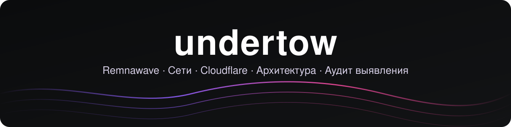
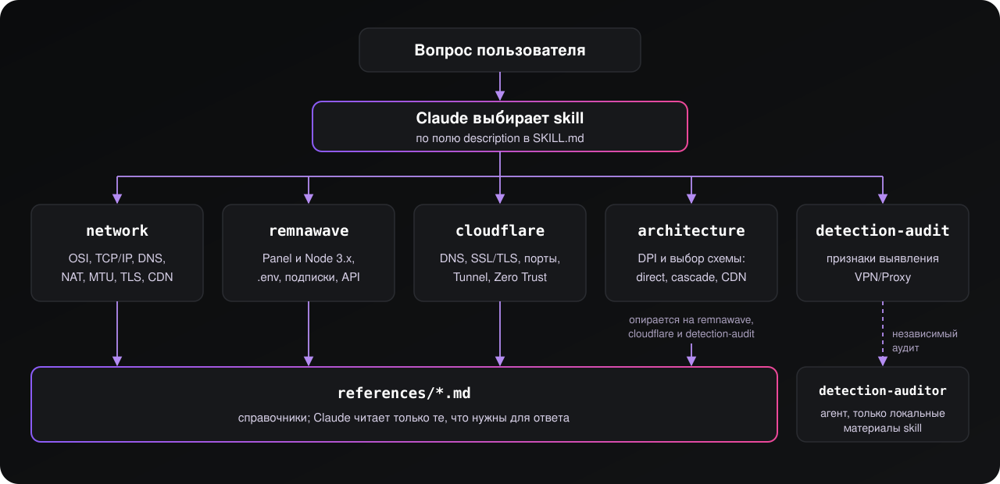

<!-- markdownlint-disable MD033 MD041 -->
<p align="center">
  
</p>

<p align="center">
  <a href="https://code.claude.com/docs/en/plugins"></a>
  <a href="plugins/undertow-ru/.claude-plugin/plugin.json"></a>
  <a href="https://docs.rw"></a>
  <a href="LICENSE"></a>
</p>

<p align="center">
  🇬🇧 <a href="README.md">English</a> · 🇷🇺 <b>Русский</b>
</p>

<p align="center">
  <a href="#установка">Установка</a> ·
  <a href="#skills">Skills</a> ·
  <a href="#лицензия">Лицензия</a>
</p>

> Русскоязычная база знаний для Claude Code: проектирование, развёртывание и аудит VPN-инфраструктуры на Remnawave — только по официальным источникам.

**Коротко:** 5 skills · 1 агент · 58 справочников · Remnawave 3.x · Cloudflare · Xray-core · Сетевые основы · Аудит признаков выявления VPN.

> [!IMPORTANT]
> **Принципы содержания**
>
> - Только официальные источники: [Remnawave Docs](https://docs.rw), [Remnawave GitHub](https://github.com/remnawave), [Cloudflare](https://developers.cloudflare.com), RFC, документация вендоров, а для аудита — локально сохранённая методика.
> - Всё, что не подтверждено источником, помечается явно; недокументированные поля и схемы не придумываются.
> - Команды даются для сервера пользователя; skills не ищут файлы на локальном компьютере.
> - Секреты (UUID, ключи, токены, ссылки подписок) не выводятся.

## Skills

| Skill | Что покрывает | Когда срабатывает |
| --- | --- | --- |
| `undertow-ru:remnawave` | Remnawave 3.x: установка и обновление Panel и Node, `.env`, reverse proxy, Node Plugins, Config Profiles, каскад между Nodes, пользователи, подписки, API, troubleshooting | Любые задачи по Remnawave Panel и Node |
| `undertow-ru:network` | Сетевые основы: OSI, TCP/IP, DNS, NAT/CGNAT, MTU/MSS, TLS/mTLS, HTTP/2 и HTTP/3, CDN, BGP, reverse proxy, firewall, Linux networking | Объяснение концепций и диагностика связности |
| `undertow-ru:cloudflare` | DNS, Proxied и DNS only, SSL/TLS-режимы, порты прокси, WebSocket и gRPC, WAF, Tunnel, Zero Trust | Публикация Panel, страницы подписки или Node через Cloudflare |
| `undertow-ru:architecture` | Диагностика блокировок (DNS, IP, SNI/TLS, fingerprint, шейпинг, UDP/QUIC) и выбор топологии: direct, cascade, CDN, selective WARP, relay | Выбор или пересмотр схемы обхода блокировок, вопросы о DPI |
| `undertow-ru:detection-audit` | Аудит схемы на признаки выявления VPN/Proxy: GeoIP, ASN, hosting, DNS, маршруты, MTU, признаки Android/iOS/desktop, задержки, HTTP-заголовки | Перед финальным решением по схеме, вопрос «заметен ли VPN» |

<details>
<summary><b>remnawave</b> — 11 справочников</summary>

| Файл | Тема |
| --- | --- |
| `install.md` | Чистая установка Panel и Node, `.env`, reverse proxy |
| `upgrade.md` | Обновление внутри 3.x и переход 2.x → 3.x, определение текущей версии |
| `discovery.md` | Поиск компонентов на сервере при нестандартной установке |
| `nodes.md` | Nodes и Node Plugins (Torrent Blocker, Ingress/Egress Filter, Connection Drop, Shared Lists) |
| `config-profiles.md` | Config Profiles, inbounds, snippets, Internal Squads, server-side routing и каскад |
| `users.md` | Пользователи, лимиты, HWID |
| `subscriptions.md` | Hosts, Templates, Response Rules, Subscription Page |
| `api.md` | REST API, API Tokens и их права |
| `happ-routing.md` | Happ Routing и его границы |
| `troubleshooting.md` | SPAWN_ERROR, xlogs, Rescue CLI, типовые ошибки |
| `sources.md` | Официальные источники |

</details>

<details>
<summary><b>network</b> — 25 справочников</summary>

`osi-model` · `tcp-ip` · `tcp-vs-udp` · `ports` · `ipv4` · `ipv6` · `routing` · `gateway` · `nat` · `cgnat` · `mtu` · `dns` · `dns-security` · `tls` · `mtls` · `https` · `http2-http3` · `cdn` · `anycast` · `bgp` · `reverse-proxy` · `load-balancing` · `firewall` · `linux-networking` · `sources`

</details>

<details>
<summary><b>cloudflare</b> — 8 справочников</summary>

`dns` · `ssl-tls` · `proxy-cdn` · `security` · `tunnel` · `zero-trust` · `remnawave-integration` · `sources`

</details>

<details>
<summary><b>architecture</b> — 1 справочник</summary>

`architecture-guide` — матрица топологий, заметки по реализации, тесты, типовые отказы.

</details>

<details>
<summary><b>detection-audit</b> — 13 справочников и исходный документ</summary>

- `official/` — сигналы выявления, GeoIP/ASN/hosting, признаки мобильных и desktop-устройств, дополнительные методы, ложные срабатывания, ограничения методики, матрица решений.
- `analysis/` — разбор инфраструктуры Remnawave, роутерного проксирования и слабых мест.
- `source-map.md`, `final-report-template.md` — карта источника и шаблон отчёта.
- `sources/` — исходный PDF методики и его дословная текстовая копия.

</details>

### Агент `detection-auditor`

Независимый аудит схемы на признаки выявления. Работает только с локальными материалами skill `detection-audit` (инструменты Read, Grep, Glob), без выхода в интернет. Claude делегирует ему проверку перед финальным решением по схеме; можно и попросить явно: «проверь схему агентом detection-auditor», передав полное описание схемы.

## Как устроено

<p align="center">
  
</p>

Каждый skill — это `SKILL.md` с правилами и маршрутизацией плюс папка `references/`. Claude читает справочник только тогда, когда он нужен для ответа, поэтому в контекст не попадает лишнее.

## Совместимость

| Компонент | Версия |
| --- | --- |
| Claude Code | С поддержкой plugins и marketplaces |
| Remnawave Panel и Node | 3.x; материалы сверены с документацией 3.4.x |
| Xray-core | В составе Remnawave Node |
| Cloudflare | Текущая документация [Cloudflare](https://developers.cloudflare.com) |

## Установка

### Claude Code

```text
/plugin marketplace add essilyasemenov/undertow
/plugin install undertow-ru@undertow
```

Обновление до новой версии:

```text
/plugin marketplace update undertow
```

Локальная разработка: `claude --plugin-dir ./undertow/plugins/undertow-ru`.

### Codex

```bash
codex plugin marketplace add essilyasemenov/undertow
codex plugin add undertow-ru@undertow
```

Обновление:

```bash
codex plugin marketplace upgrade undertow
```

В Codex доступны все skills. Плагины Codex не поставляют агентов, поэтому `detection-auditor` ставится отдельным файлом в `~/.codex/agents/`:

```bash
mkdir -p ~/.codex/agents
curl -o ~/.codex/agents/detection-auditor.toml https://raw.githubusercontent.com/essilyasemenov/undertow/main/plugins/undertow-ru/codex/agents/detection-auditor.toml
```

## Разработка

```bash
npx --yes markdownlint-cli2@0.24.1 '**/*.md'
claude plugin validate .
python3 scripts/check-sync.py
uvx --from cisco-ai-skill-scanner skill-scanner scan-all ./plugins/undertow-ru/skills --recursive --check-overlap --format markdown --detailed --output /tmp/undertow-skill-scan.md
```

## Поддержать проект

Если undertow экономит вам время, развитие проекта можно поддержать криптовалютой:

| Монета | Сеть | Адрес |
| --- | --- | --- |
| Ethereum (ETH) | ERC-20 | `0x9d835959c399024501546086e651e5ee409941b7` |
| Tether (USDT) | TRC-20 | `TXuNY22XZBC4VWNBEuMvTppFgNZfd7YdYt` |

Перед отправкой проверьте сеть: средства, отправленные не в той сети, вернуть нельзя.

## Лицензия

Лицензия — [MIT](LICENSE).

Проект не связан с [Remnawave](https://docs.rw/), [Cloudflare](https://www.cloudflare.com/) или [Anthropic](https://www.anthropic.com/) и не одобрен ими.

Названия продуктов принадлежат их владельцам.
